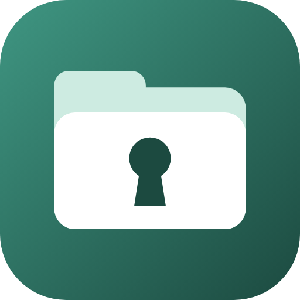

# Bestandskluis

Android-app (Flutter) die een bestandsbeheerder, foto- en videogalerij, FTP(S)-server en versleutelde mappen combineert.

[](https://github.com/Hidde-Balestra/bestandskluis/actions/workflows/ci.yml)
[](https://github.com/Hidde-Balestra/bestandskluis/releases/latest)

**Download:** de nieuwste getekende APK staat bij [Releases](https://github.com/Hidde-Balestra/bestandskluis/releases/latest).

## Functies

### Bestanden
- Bladeren door interne opslag en SD-kaart, met snelkoppelingen (Downloads, Camera, …)
- Lijst- en galerijweergave; in kluizen ook **miniaturen van versleutelde foto's** (alleen in het werkgeheugen ontsleuteld, nooit op schijf)
- **Zoeken** in de huidige map en alle submappen (ook op versleutelde namen in ontgrendelde kluizen)
- **Sorteren** op naam, datum of grootte
- Kopiëren, knippen/plakken, hernoemen, verwijderen, nieuwe map, delen
- **Zip**: inpakken en uitpakken, ook in en uit kluizen (met bescherming tegen "zip slip")
- Meerdere items selecteren (lang indrukken) of **alles selecteren** met de knop bovenin
- **Delen naar Bestandskluis**: in elke app *Delen → Bestandskluis* en het bestand gaat versleuteld een kluis in
- **Prullenbak**: verwijderde bestanden blijven 30 dagen terug te zetten; items uit een kluis blijven daarbij versleuteld (in de kluis zelf)
- **Notities**: tekstbestanden bekijken en bewerken in de app; in een kluis alleen in het geheugen ontsleuteld (*+ → Nieuwe notitie*)
- **Duplicaten zoeken** (ook tussen kluis en gewone mappen, op inhoud) en **opslaganalyse** (grootste mappen en bestanden), via het menu van een map

### Galerij
- Alle foto's en video's van het toestel per album
- Viewer met zoomen, vegen, een videospeler en een **diavoorstelling**
- **Video's in een kluis afspelen zonder kopie op schijf**: een lokale stream (127.0.0.1, geheime token per bestand) ontsleutelt alleen het gevraagde stuk
- **Foto's bewerken**: draaien en bijsnijden, ook in een kluis (alles in het geheugen)
- **Favorieten en albums** in kluizen (versleuteld opgeslagen in de kluis zelf)
- **Verwijderen** in de viewer en bij een selectie; miniaturen van versleutelde video's met duur
- Alles selecteren (hele album) om te delen of naar een kluis te verplaatsen
- **Naar kluis verplaatsen**: selecteer foto's/video's, versleutel ze in een kluis en verwijder ze uit de galerij
- **Nieuwe camerafoto's automatisch naar een kluis** (instelbaar): gebeurt zodra de app open is en die kluis ontgrendeld is
- Tabblad **Kluizen**: foto's en video's uit ontgrendelde kluizen

### Versleutelde mappen (kluizen)
- **Nieuwe kluis**: op het startscherm of in elke map via de **+**-knop
- Bestaande map versleutelen: **Map versleutelen** in het menu van de map, of **+ → Deze map versleutelen**
- **Bestandsnamen versleutelen** (keuze bij het maken van de kluis): zonder wachtwoord is niet te zien hoe bestanden heten (`a8f3…kx2.bkx`). Mapnamen blijven leesbaar.
- **Wachtwoord wijzigen** zonder alle bestanden opnieuw te versleutelen
- **Herstelcode**: een code van 24 tekens om de kluis te openen als je het wachtwoord vergeet (daarna stel je een nieuw wachtwoord in)
- **Mijn kluizen** op het startscherm: alle kluizen, ook vergrendelde
- **Ontgrendelen met vingerafdruk**: de kluissleutel staat in een Android Keystore-sleutel die alleen na een vingerafdrukscan wordt vrijgegeven (Android 9+). Een nieuw toegevoegde vingerafdruk maakt die sleutel ongeldig; dan is één keer het wachtwoord nodig. Op Android 7/8 controleert de app de vingerafdruk.
- **Schermbeveiliging**: zolang een kluis open is geen schermafbeeldingen en verborgen inhoud in "recente apps"
- **Vergrendelen als het scherm uitgaat** of als je de telefoon **met het scherm naar beneden** legt (instelbaar)
- **Widget** op het startscherm: *Vergrendelen* (alles op slot) en *Kluis openen* (laatst gebruikte kluis, met vingerafdruk)
- **Locatie en EXIF verwijderen bij delen** (standaard aan): JPEG zonder opnieuw te comprimeren, PNG-tekstblokken weg
- Automatisch vergrendelen na 1, 5 (standaard), 15 of 30 minuten op de achtergrond, of nooit
- **Indringersfoto** (optioneel): na 3 verkeerde wachtwoorden maakt de voorcamera ongemerkt een foto, versleuteld bewaard. Bekijken kan alleen na vingerafdruk of schermvergrendeling.
- **Delen = tijdelijk ontsleutelen**: bij delen wordt een ontsleutelde kopie in de cache van de app gemaakt. Die wordt na 10 minuten verwijderd, en in elk geval bij de volgende start van de app.

### FTP
- **Eigen FTP-server** op je toestel: gedeelde map, poort, gebruiker/wachtwoord, alleen-lezen of anoniem
- **FTPS** (expliciet, `AUTH TLS`): uit, optioneel (standaard) of verplicht. Het certificaat wordt op de telefoon gemaakt; de vingerafdruk staat in de app. Werkt met FileZilla, WinSCP, enz.
- **Op de achtergrond**: de server blijft draaien met het scherm uit of in een andere app (melding met *Stoppen*)
- **QR-code**: scan met een andere telefoon om meteen te verbinden. Met Bestandskluis op die telefoon wordt ook het certificaat gecontroleerd.
- **Kluizen via FTP**: bestanden in *ontgrendelde* kluizen worden tijdens het downloaden ontsleuteld; uploads naar een kluis worden direct versleuteld. Vergrendelde kluizen geven alleen versleutelde bestanden.
- **FTP-client** met FTPS: het servercertificaat wordt de eerste keer onthouden en daarna gecontroleerd (een gewijzigd certificaat wordt geweigerd)
- **Back-up van kluizen naar je FTP-server**: handmatig of elke nacht automatisch (op wifi). Alleen de versleutelde bestanden gaan over de lijn, precies zoals ze op de telefoon staan. De kluis hoeft daarvoor niet open te zijn en de server ziet nooit iets onversleuteld. Alleen gewijzigde bestanden worden verstuurd. **Terugzetten** (bijv. op een nieuwe telefoon) kan met één knop bij *Instellingen*.

## Beveiliging

| Onderdeel | Keuze |
|---|---|
| Kluissleutel | Willekeurig (256 bit), ingepakt met AES-256-GCM door een sleutel uit het wachtwoord (en eventueel uit de herstelcode) |
| Sleutel uit wachtwoord | PBKDF2-HMAC-SHA256, 210.000 iteraties, 16-byte salt |
| Sleutel per bestand | HKDF-SHA256(kluissleutel, willekeurige salt van 16 bytes) |
| Versleuteling | AES-256-GCM in blokken van 256 KiB (streaming, ook voor grote video's) |
| Integriteit | GCM-tag per blok; de AAD bevat de header en een "laatste blok"-vlag, zodat wijzigen, omwisselen of afkappen wordt herkend |
| Bestandsnamen (optioneel) | AES-256-GCM met een eigen sleutel (HKDF), nonce = HMAC van de naam (deterministisch, zodat bestanden op naam te vinden zijn) |
| Vingerafdruk | Android Keystore, sterke biometrie, ongeldig bij nieuwe vingerafdruk |
| FTPS | TLS met zelfondertekend EC-certificaat (P-256), vastgepind door de client |

Kluizen van versie 1 (v1.0–v1.2) blijven werken en worden versie 2 zodra je het wachtwoord wijzigt. Zonder wachtwoord én zonder herstelcode is een kluis **niet** te herstellen.

Bestandsformaat (`.bkv`/`.bkx`): `"BKV1"` · blokgrootte (u32) · salt (16 bytes), daarna blokken `AES-GCM(blok) || tag(16)` met nonce = bloknummer.

## Ontwikkelen

```bash
flutter pub get
flutter analyze
flutter test           # crypto, kluizen, namen, herstelcode, FTP(S), back-up, zip
flutter run
```

Een lokale release-build heeft `android/key.properties` nodig (zie hieronder). Voor een snelle test zonder sleutel: `flutter build apk --debug`.

## Releases en signing

Releases worden gebouwd door GitHub Actions ([release.yml](.github/workflows/release.yml)):

```bash
# versie in pubspec.yaml aanpassen, dan:
git tag v1.3.1
git push origin v1.3.1
```

De workflow test de code, bouwt de APK, tekent hem met de release-sleutel, controleert de handtekening met `apksigner` en publiceert een GitHub-release met de APK en `SHA256SUMS.txt`.

**Signing**
- De release-sleutel staat als repository-secrets: `ANDROID_KEYSTORE_BASE64`, `ANDROID_KEYSTORE_PASSWORD`, `ANDROID_KEY_ALIAS`, `ANDROID_KEY_PASSWORD`.
- De repo-variabele `ANDROID_CERT_SHA256` bevat de verwachte vingerafdruk van het certificaat. De release faalt als de APK met een andere sleutel (of de debug-sleutel) is getekend.
- Ontbreken de secrets, dan faalt de release. Ook Gradle weigert een release-build zonder `android/key.properties`.
- Certificaat SHA-256: `86:A8:2A:37:DB:38:3C:C8:FB:1D:0C:EC:A0:18:A2:7B:D9:B5:9C:A5:47:9F:8A:A0:97:21:FE:EA:DE:22:61:F1`

Lokaal staan `android/key.properties` en `android/app/upload-keystore.jks` (beide in `.gitignore`). **Bewaar een back-up van deze twee bestanden.** Zonder dezelfde sleutel kunnen bestaande installaties niet meer worden bijgewerkt.

## Logo

Het logo wordt in code getekend ([lib/widgets/app_logo.dart](lib/widgets/app_logo.dart)). De Android-iconen (klassiek, adaptief en monochroom voor thema-iconen) en `docs/logo.png` genereer je opnieuw met:

```bash
flutter test tool/generate_icons_test.dart
```
